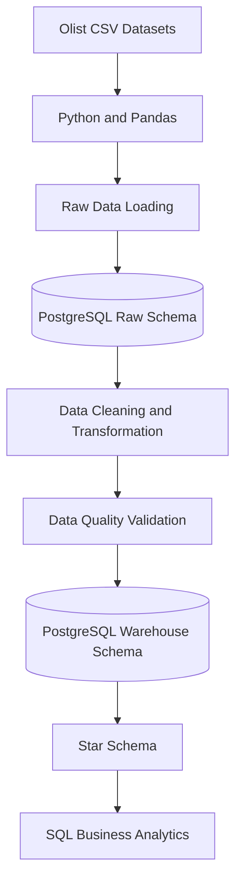

# End-to-End E-commerce Data Pipeline
### Mini Data Warehouse using Python, PostgreSQL and Docker

## Project Overview

This project builds an end-to-end ETL (Extract, Transform, Load) pipeline using the Brazilian E-Commerce Public Dataset by Olist.

The pipeline extracts data from multiple CSV files, loads the original data into PostgreSQL, performs data cleaning and validation, and transforms it into a structured star-schema data warehouse for business analysis.

The project demonstrates practical Data Engineering and Data Analytics concepts, including data integration, ETL automation, relational database design, data quality checks, Docker containerization, and SQL analytics.

## Business Problem

E-commerce businesses generate large amounts of data related to customers, orders, products, and sellers.

When this data is stored in separate files, it becomes difficult to analyze business performance and generate meaningful insights.

This project solves that problem by building a centralized data pipeline and a PostgreSQL data warehouse that supports structured business analysis.

## Dataset

**Source:** Brazilian E-Commerce Public Dataset by Olist (Kaggle)

The project uses five main datasets:

- `olist_customers_dataset.csv`
- `olist_orders_dataset.csv`
- `olist_order_items_dataset.csv`
- `olist_products_dataset.csv`
- `olist_sellers_dataset.csv`

Download the datasets from Kaggle and place the CSV files inside `data/raw/`.

Dataset files are not included in this GitHub repository.

## Project Architecture



## Technology Stack

| Technology | Purpose |
|---|---|
| Python | ETL pipeline development |
| Pandas | Data processing and transformation |
| SQLAlchemy | Database connectivity |
| PostgreSQL 16 | Relational database and warehouse |
| Docker | Containerization |
| Docker Compose | Service orchestration |
| SQL | Business analysis |
| Git and GitHub | Version control |

## Project Folder Structure

```text
olist-ecommerce-data-pipeline/
│
├── data/
│   └── raw/
│       └── Olist CSV files
│
├── docs/
│   └── data_dictionary.md
│
├── logs/
│   └── pipeline.log
│
├── sql/
│   └── analysis_queries.sql
│
├── src/
│   ├── __init__.py
│   ├── config.py
│   ├── pipeline.py
│   └── test_connection.py
│
├── .gitignore
├── docker-compose.yml
├── Dockerfile
├── requirements.txt
└── README.md
```

## ETL Pipeline

### 1. Extract

- Read multiple Olist CSV datasets using Pandas.
- Load source data into PostgreSQL raw schema.

### 2. Transform

- Handle date and data types.
- Validate required keys.
- Remove exact duplicate records where applicable.
- Check negative price and freight values.
- Prepare fact and dimension tables.

### 3. Load

- Load transformed data into PostgreSQL warehouse schema.
- Create primary key and foreign key constraints.
- Organize data using a star schema.

## Database Design

The database contains two schemas.

### 1. Raw Schema

Stores the source datasets in relational tables.

- `raw.customers`
- `raw.orders`
- `raw.order_items`
- `raw.products`
- `raw.sellers`

### 2. Warehouse Schema

Designed for analytical queries using a star schema.

**Fact Table**

`warehouse.fact_sales`

Contains sales transaction details such as:

- order_id
- order_item_id
- product_id
- seller_id
- customer_id
- date_key
- price
- freight_value

**Dimension Tables**

- `warehouse.dim_customers`
- `warehouse.dim_products`
- `warehouse.dim_sellers`
- `warehouse.dim_date`

The fact table uses `(order_id, order_item_id)` as its primary key. Dimension keys are connected through foreign key relationships.

## Data Quality Checks

The pipeline includes the following validation checks:

1. Required primary and business keys must not contain null values.
2. Duplicate order-item records are checked.
3. Negative product prices and freight values are checked.
4. Source CSV row counts are compared with raw database row counts.
5. Fact table keys are checked for nulls and duplicates.
6. Dimension key uniqueness is validated.
7. Primary key and foreign key constraints are applied.

The pipeline logs successful validations and raises errors when required checks fail.

## Logging

Pipeline execution details and validation results are logged.

Log file:

`logs/pipeline.log`

The pipeline also displays execution messages in the Docker container output.

## SQL Business Analysis

The project includes five analytical SQL queries in:

`sql/analysis_queries.sql`

The queries cover:

1. **Monthly Revenue Analysis:** Monthly sales-value proxy and cumulative running total.
2. **Product Category Analysis:** Top 10 product categories by sales value.
3. **Seller Performance:** Seller ranking using DENSE_RANK().
4. **Product Performance:** Top three products within each category using CTE and ROW_NUMBER().
5. **Customer Analysis:** Customer lifetime sales-value proxy and ranking.

SQL concepts used:

- INNER JOIN
- GROUP BY
- Aggregate Functions
- Common Table Expressions (CTEs)
- Window Functions
- SUM() OVER()
- DENSE_RANK()
- ROW_NUMBER()
- COUNT(DISTINCT)

## Verified Project Results

The following results were verified during project execution:

| Metric | Verified Result |
|---|---:|
| Fact sales records loaded | 112,650 |
| Total item price | BRL 13,591,643.70 |
| Average item price | BRL 120.65 |
| Date dimension records | 634 |

**Note:** Total item price is calculated using `price` only. The SQL analysis queries use `price + freight_value` as a sales-value proxy. These are different metrics. The proxy is not accounting revenue.

## How to Run the Project

### Prerequisites

- Python 3.11 or compatible environment
- Docker Desktop
- Git
- Olist CSV datasets

### Step 1: Clone the Repository

```bash
git clone https://github.com/vaishnavijoshi438-oss/olist-ecommerce-data-pipeline.git
```

### Step 2: Open the Project Folder

```bash
cd olist-ecommerce-data-pipeline
```

### Step 3: Add Dataset Files

Download the five Olist CSV files and place them inside:

```text
data/raw/
```

Keep the original filenames unchanged.

### Step 4: Start the Pipeline

Make sure Docker Desktop is running.

```bash
docker compose up --build
```

The PostgreSQL database starts first. The pipeline waits for database readiness, loads raw data, transforms the data, builds warehouse tables, applies constraints, and logs the results.

The pipeline can be executed again to reload and rebuild the tables.

### Step 5: Run SQL Analysis

After the pipeline completes, open another terminal in the project folder and execute:

```powershell
docker exec -i olist_postgres psql -U ecommerce_user -d ecommerce < sql/analysis_queries.sql
```

### Step 6: Stop Containers

```bash
docker compose down
```

To delete the database volume and all stored database data:

```bash
docker compose down -v
```

**Warning:** The second command permanently deletes the local PostgreSQL database volume.

## Project Limitations

- The project uses a local PostgreSQL database hosted through Docker.
- No cloud platform or workflow orchestration tool is used.
- The sales-value proxy does not account for refunds, payment status, or cancellations.
- This is a portfolio-scale project and not a production financial reporting system.

## Future Improvements

- Add automated scheduled pipeline execution.
- Add more advanced data quality monitoring.
- Integrate business intelligence dashboards.
- Deploy the warehouse to a cloud database.

## Author

**Vaishnavi Joshi**

B.Sc. Data Science

GitHub: https://github.com/vaishnavijoshi438-oss

---

**Project:** End-to-End E-commerce Data Pipeline – Mini Data Warehouse

**Domain:** Data Engineering | E-commerce Analytics