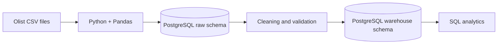

# End-to-End E-commerce Data Pipeline (Mini Data Warehouse)

## Problem
E-commerce businesses receive order, customer, product, and seller data in separate files. This project builds a repeatable ETL pipeline that loads raw CSV data, validates and transforms it, and prepares a PostgreSQL star-schema warehouse for analysis.

## Dataset
Brazilian E-Commerce Public Dataset by Olist (Kaggle). Use these five original CSV files:
- `olist_orders_dataset.csv`
- `olist_order_items_dataset.csv`
- `olist_customers_dataset.csv`
- `olist_products_dataset.csv`
- `olist_sellers_dataset.csv`

Download the dataset from Kaggle and place the five files in `data/raw/`. The dataset is not included in this repository ZIP.

## Architecture



## Tech stack
Python 3.11, pandas, SQLAlchemy, PostgreSQL 16, Docker Compose, Git.

## Folder structure
```text
data/raw/       Original Olist CSV files (not committed)
src/            Python pipeline
sql/            Analysis queries
docs/           Project documentation
docker-compose.yml
Dockerfile
requirements.txt
README.md
.gitignore
```

## How to run
1. Install Docker Desktop and start it.
2. Download the five Olist CSV files from Kaggle.
3. Copy them into `data/raw/` without renaming them.
4. From the project root, run:

```bash
docker compose up --build
```

The PostgreSQL service starts first. The Python pipeline waits for the database, loads the CSVs into `raw`, builds the `warehouse` tables, applies constraints, and logs progress. Re-running the command reloads the raw tables and rebuilds warehouse tables, avoiding duplicate rows.

To stop the services:
```bash
docker compose down
```

To stop and delete the local PostgreSQL volume (this permanently deletes the loaded database):
```bash
docker compose down -v
```

## Database schema
### Raw schema
- `raw.orders`
- `raw.order_items`
- `raw.customers`
- `raw.products`
- `raw.sellers`

Raw tables preserve the source CSV columns and values as loaded by pandas.

### Warehouse schema
- `warehouse.fact_sales`: order_id, order_item_id, product_id, seller_id, customer_id, date_key, price, freight_value
- `warehouse.dim_customers`
- `warehouse.dim_products`
- `warehouse.dim_sellers`
- `warehouse.dim_date`

`fact_sales` uses `(order_id, order_item_id)` as its primary key because an order can contain multiple items. Dimension primary keys are referenced by foreign keys in the fact table.

## Data quality checks
The pipeline stops with a clear error if:
1. Required primary/business keys contain nulls.
2. Duplicate `(order_id, order_item_id)` records are found after exact duplicate removal.
3. Product prices or freight values are negative.
4. Raw PostgreSQL row counts differ from the corresponding CSV row counts.
5. Fact table keys are null, duplicate at the order-item grain, or the fact table is empty.

It also checks uniqueness of dimension keys and adds database primary/foreign key constraints.

## Logging
Pipeline progress and row counts are printed to the container output and appended to `logs/pipeline.log`. Each validation logs PASS or raises a clear FAIL error.

## SQL analysis
Run the five queries in `sql/analysis_queries.sql` against the `ecommerce` database. They cover:
- Monthly revenue with a running total
- Top product categories by revenue
- Seller revenue ranking
- Top three products within each category
- Customer lifetime revenue ranking

## Example results
Run the pipeline and SQL queries first, then add your real row counts and query outputs here. Do not estimate or invent results.

## Limitations and notes
- The project uses a local Dockerized PostgreSQL database; no cloud or orchestration platform is required.
- `price + freight_value` is used as a simple sales-value proxy; it is not accounting revenue and does not include refunds, payment status, or cancellations.
- This is a portfolio-scale pipeline, not a production payment or financial reporting system.
